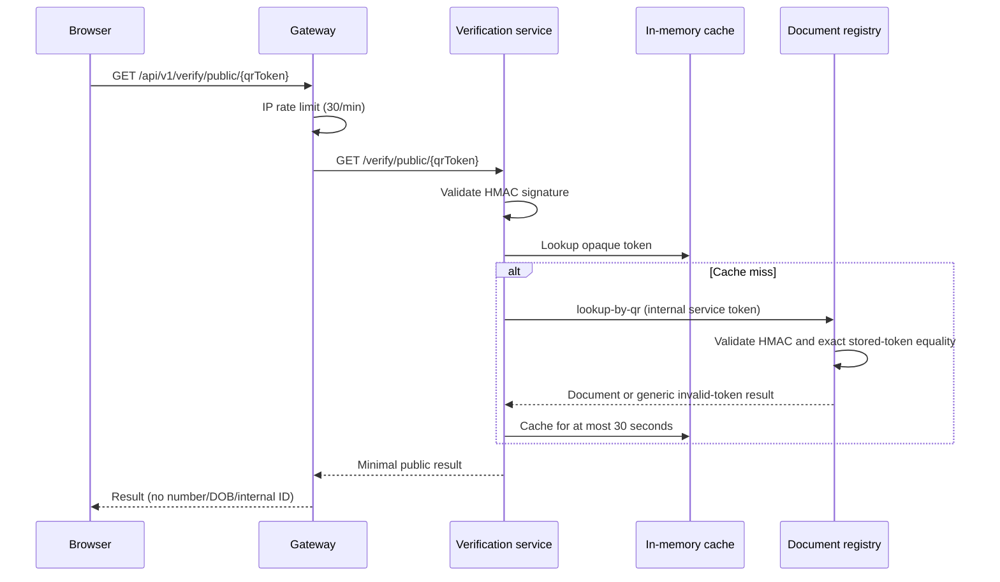
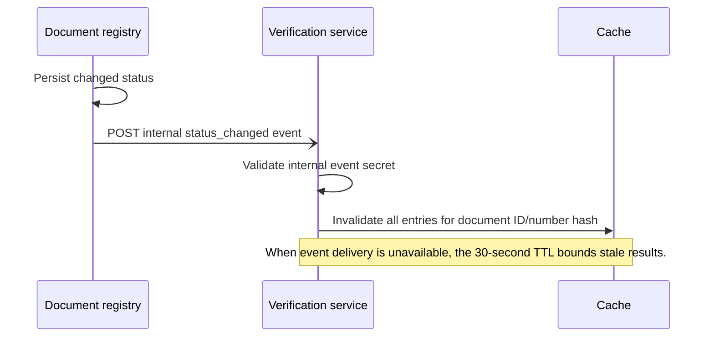
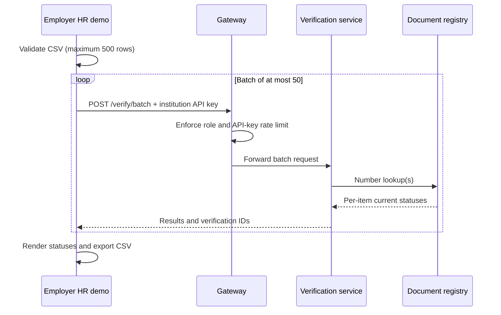

# Architecture

The gateway exposes versioned contracts while internal service-to-service registry routes are not routed externally. The public web app and the independently built Employer HR client use the same verification API.

## Public QR verification



## Institution number check with cache hit/miss

```mermaid
sequenceDiagram
  participant HR as Institution client
  participant G as Gateway
  participant V as Verification service
  participant C as Cache
  participant R as Document registry
  HR->>G: POST /verify/number + API key
  G->>G: Authenticate policy and 300/min key limit
  G->>V: POST /verify/number
  V->>V: Validate approved institution; HMAC document number
  V->>C: Lookup numberHash + type
  alt Cache hit
    C-->>V: Current cached registry response
  else Cache miss
    V->>R: Internal lookup by type and number
    R-->>V: Current record/status or no record
    V->>C: Cache result for 30 seconds
  end
  V-->>HR: Full institution response, masked number
  V--)V: Asynchronously persist log and publish performed event
```

## Status event invalidation



## Employer batch flow


